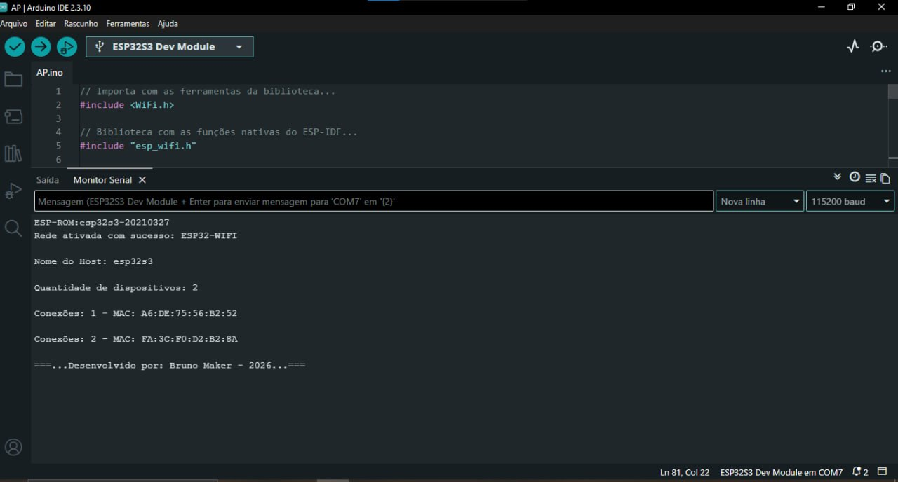

# AP

Sketch para Arduino IDE que transforma o ESP32 em um ponto de acesso Wi-Fi (Access Point). O ESP32 cria a própria rede, com IP fixo, e mostra no Monitor Serial o nome da rede, o host, a quantidade de aparelhos conectados e o endereço MAC de cada um.

[](AP.ino)

## O que ele faz

1. Define o nome do host do ponto de acesso (`esp32s3`).
2. Configura o IP fixo, o gateway e a máscara de sub-rede.
3. Cria a rede Wi-Fi com nome e senha definidos no código, no canal 1, com limite de 4 aparelhos conectados ao mesmo tempo.
4. Mostra no monitor que a rede foi ativada, com o nome da rede, e o nome do host.
5. Espera 10 segundos para dar tempo de conectar um aparelho antes da primeira leitura.
6. A cada 1 segundo, consulta a lista de aparelhos conectados e só imprime na serial quando a quantidade muda.
7. Para cada aparelho, mostra o endereço MAC em hexadecimal.

## Requisitos

- Placa ESP32 (testado com ESP32-S3)
- Arduino IDE 2.3.10
- Pacote de placas **esp32** (Espressif) instalado

Não precisa instalar bibliotecas extras. O sketch usa `WiFi.h` e `esp_wifi.h`, que já vêm com o pacote da placa.

## Configuração da rede

| Opção | Valor |
| --- | --- |
| Nome da rede | ESP32-WIFI |
| Senha da rede | 45928866 |
| Nome do host | esp32s3 |
| IP local | 192.168.10.1 |
| Gateway | 192.168.10.1 |
| Máscara de sub-rede | 255.255.255.0 |
| Canal | 1 |
| Limite de conexões | 4 |

O nome e a senha da rede ficam nas variáveis `nome_rede` e `senha_rede`, e os valores acima são de teste. A senha precisa ter no mínimo 8 caracteres, senão o ESP32 não cria a rede.

## Configuração da IDE

| Opção | Valor |
| --- | --- |
| Placa | ESP32S3 Dev Module |
| USB CDC On Boot | **Enabled** |
| Velocidade do monitor | 115200 baud |
| Final de linha no monitor | Nova linha |

> **Atenção:** no ESP32-S3, com o **USB CDC On Boot** desativado, o Monitor Serial não mostra nada. Ative a opção em Ferramentas antes de gravar.

## Como usar

> **Atenção:** a pasta do projeto precisa ter o mesmo nome do arquivo `.ino` (`AP`). A Arduino IDE exige isso, e com nomes diferentes ela dá erro ao abrir o sketch.

1. Abra `AP.ino` na Arduino IDE.
2. Selecione a placa e a porta em Ferramentas.
3. Grave o sketch na placa.
4. Abra o Monitor Serial em 115200 baud com final de linha **Nova linha**.
5. No celular ou no computador, procure a rede `ESP32-WIFI` e conecte usando a senha `45928866`.
6. Acompanhe no monitor a quantidade de aparelhos conectados e o MAC de cada um.

## Exemplo de saída



### Rede ativada e aparelhos conectados

```
Rede ativada com sucesso: ESP32-WIFI

Nome do Host: esp32s3

Quantidade de dispositivos: 2

Conexões: 1 - MAC: A6:DE:75:56:B2:52

Conexões: 2 - MAC: FA:3C:F0:D2:B2:8A

===...Desenvolvido por: Bruno Maker - 2026...===
```

### Erro na leitura da lista

Se o ESP32 não conseguir recuperar a lista de aparelhos conectados, ele avisa no monitor e tenta de novo no próximo segundo:

```
Erro ao recuperar a lista de pontos de acesso!
```

## Estrutura

```
├── AP.ino
├── README.md
└── imagens/
    └── ap.jpg
```

🚀 Próximos projetos
Outros projetos serão postados em breve, com topologias diferentes e níveis de complexidade maiores.

👤 Autor: Bruno Zucker
